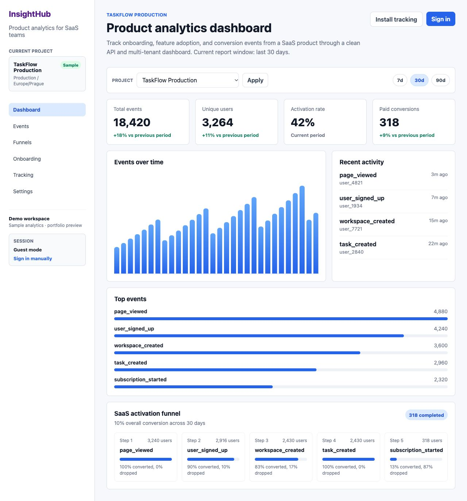
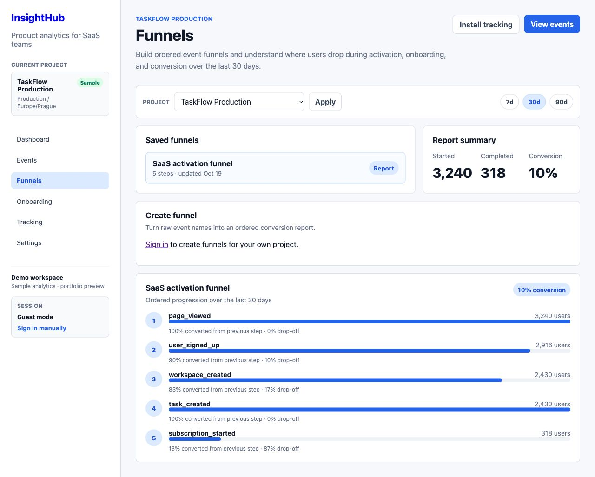

# InsightHub

[](https://github.com/R1washere/insighthub/actions/workflows/ci.yml)

InsightHub is a full-stack product analytics demo for B2B SaaS teams. It
tracks custom events, manages project API keys, and turns raw product activity
into dashboards, event exploration and funnel reports.

This is a personal portfolio project built from scratch. It does not contain
proprietary code, data, internal architecture, or business logic from any
employer.

**[Open live demo](https://project-2dut5.vercel.app/)** ·
[Portfolio case study](docs/portfolio-case-study.md) ·
[Technical reviewer guide](docs/reviewer-guide.md)

## Try It in One Minute

No account is required to explore the **sample preview**:

1. Open the [dashboard](https://project-2dut5.vercel.app/) and switch projects
   or the 7/30/90-day report window.
2. Open [Events](https://project-2dut5.vercel.app/events) and filter an event name.
3. Open [Funnels](https://project-2dut5.vercel.app/funnels) to inspect conversion
   and drop-off across ordered steps.
4. Review [Tracking](https://project-2dut5.vercel.app/tracking) for the integration
   examples.

Guest charts use synthetic sample data, not customer traffic or business results.
To try the real backend, [register a separate account](https://project-2dut5.vercel.app/register),
create an organization and project, then send test events using the Tracking
instructions and your own project ingestion key. New accounts start empty;
their reports do not inherit the guest sample data. Keep ingestion keys out of
public screenshots and never reuse account tokens in tracking code.

This is a personal portfolio deployment, not a commercial analytics service.
The API runs on a free tier and may take about a minute to wake after inactivity.
Use synthetic data only; see [known limits](docs/deployment.md#current-product-and-security-limits).
The deployment-ready application code is merged into `main`. The published demo
and API are live-verified; deployment and security details are documented below.

## Quick Review

- Full-stack monorepo with Next.js UI, NestJS API, Prisma schema, shared
  TypeScript contracts and a browser tracking SDK.
- Product area: authentication, API keys, event ingestion, analytics
  dashboards, event exploration and funnel reports.
- Review path: start with the screenshots, then open
  `docs/reviewer-guide.md`, `docs/architecture.md` and
  `docs/database-model.md`, plus `docs/api-examples.md` and `ROADMAP.md`.
- Verification path: run `pnpm verify` for local checks, builds and smoke
  tests.

## Screenshots

Current public guest preview; all figures below are synthetic.





## What I Built

- Multi-tenant organization and project model.
- JWT authentication with register, login and current-user endpoints.
- API key lifecycle with one-time raw key display, hashed storage and revoke.
- Public event ingestion endpoint with API key auth and rate limiting.
- Analytics dashboard with project switching and 7/30/90 day windows.
- Event explorer with actor, timestamp, event name and JSON property details.
- Funnel builder and saved conversion reports.
- Browser tracking SDK with queueing, retry, `identify()` and manual `flush()`.
- Onboarding flow for creating the first organization, project and API key.
- PostgreSQL seed data for fast local review and hosted persistence.

## Stack

- Next.js
- React
- NestJS
- TypeScript
- Prisma
- PostgreSQL
- pnpm workspaces

## Project Structure

```txt
apps/web           Next.js analytics dashboard
apps/api           NestJS backend API
packages/browser   Browser tracking SDK
packages/shared    Shared TypeScript contracts
prisma             PostgreSQL schema, migrations, and seed data
scripts            Local setup, verification and smoke tests
```

## Local Setup

```bash
pnpm install
cp .env.example .env
docker compose up -d
pnpm db:setup
pnpm dev
```

`pnpm db:setup` only resets databases running on localhost. Hosted databases
must use `pnpm db:deploy`, which applies pending migrations without deleting
data.

Web app: `http://localhost:3000`

API: `http://localhost:4000/api`

If port `3000` is already in use, run the web app on another port:

```bash
WEB_PORT=3001 WEB_BASE_URL=http://localhost:3001 pnpm dev
```

## Local Demo Flow

1. Open `http://localhost:3000/login`.
2. Click "Use demo account".
3. Review dashboard metrics and report windows.
4. Open Events and filter by event name.
5. Create or inspect a funnel report.
6. Open Tracking and Settings to review API key management.

The demo-login button is enabled by `.env.example` for local development only.
It is disabled on the public deployment; the public guest preview needs no login.

Useful API calls:

```bash
curl http://localhost:4000/api/health

curl -X POST http://localhost:4000/api/auth/login \
  -H "content-type: application/json" \
  -d '{"email":"demo@insighthub.dev","password":"password123"}'
```

## Verification

```bash
pnpm verify
```

The verification script resets the local PostgreSQL database, runs package checks,
typechecks, builds production bundles, starts both local apps, runs smoke
tests, checks key web routes, and restores seeded demo data.

## Free Hosting

The recommended no-cost setup is Vercel Hobby for the Next.js frontend, a
Render Free web service for the NestJS API, and Neon Free for PostgreSQL. See
`docs/deployment.md` for the exact settings and secret-handling checklist.

## Notes

- Architecture overview: `docs/architecture.md`
- Database notes: `docs/database-model.md`
- Browser SDK README: `packages/browser/README.md`
- Reviewer guide: `docs/reviewer-guide.md`
